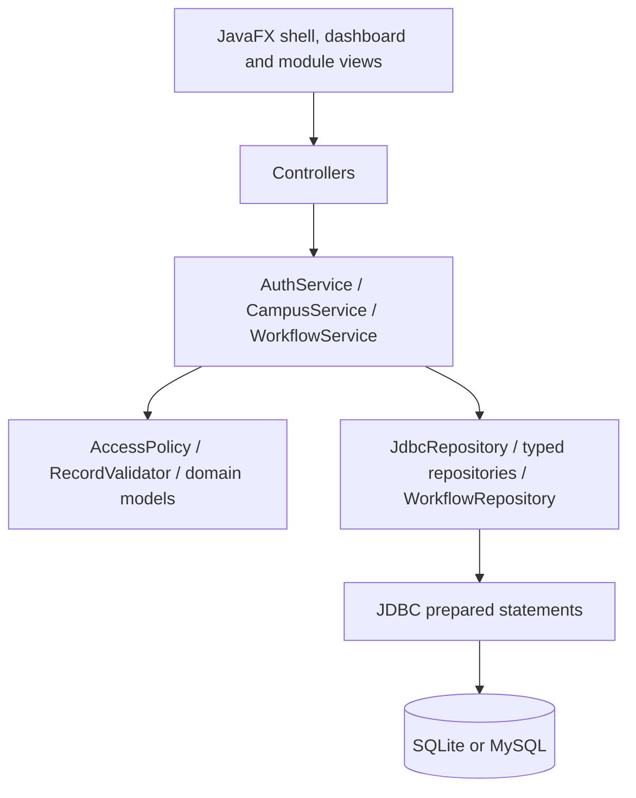
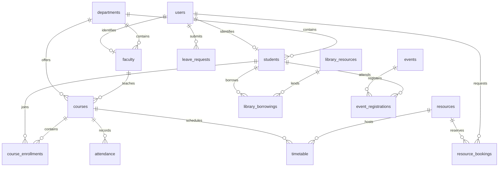

# Architecture

## Layers

`ModuleCatalog` supplies field metadata, navigation labels and role capabilities. `RecordForm` and `ModuleController` reuse this metadata while `WorkflowController` presents dedicated commands for transactions that must not be ordinary CRUD.

`AccessPolicy` scopes reads and edits to the signed-in user's identity, course assignments and project memberships. It creates a transaction-scoped relationship cache. `AuthService` owns BCrypt authentication, linked profiles and password management. `Session` contains an immutable user identity and is cleared on logout.

`WorkflowService` delegates to BookingWorkflow, AcademicWorkflow, RequestWorkflow and LibraryWorkflow. Every mutation performs validation and changes on a single connection; a failure rolls back the domain operation and its audit/notification writes together.

## Core relationships

See the SQL resources for all constraints and the complete table set. Nullable `user_id` permits administrators to create profiles before provisioning logins. Resource subtype tables hold optional subtype-specific properties while the resource factory maps the common type into the OOP hierarchy. Prepared statement values are bound; dynamic identifiers are checked against table allowlists and identifier patterns.

## Time and concurrency

Dates and local datetimes are stored as canonical ISO strings; ISO date order supports predictable comparisons. Intervals are half-open: the end of one booking may equal the start of the next. Weekly schedules and dated overrides are checked when booking rooms. Faculty replacement considers weekly classes, other replacements and approved leave.

SQLite `BEGIN IMMEDIATE` prevents two writers from validating against the same stale state. MySQL serializes mutations using an InnoDB mutex row, then locks domain parent records. This intentionally favors correctness and clarity over high write throughput. The transaction mutex also protects first-administrator setup and capacity reductions.

All large UI-facing operations are submitted through `Background.run`. Task success/failure handlers run on the JavaFX thread. Form dialogs remain open on validation failure and disable Save while persistence runs. CSV serialization quotes fields, preserves newlines and neutralizes leading spreadsheet formula characters.
